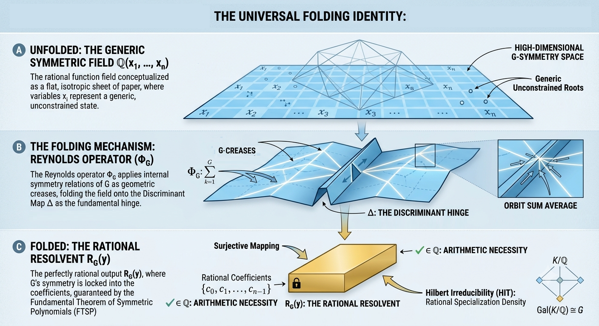

# 
Orbit Sum Origami

## 
<i>A Machine-Certified Universal Folding Approach to the Inverse Galois Problem</i>

## Overview

The Inverse Galois Problem is historically framed as an "obstruction" search—an attempt to find reasons why a group $G$ cannot manifest as a Galois group over $\mathbb{Q}$. This work shifts that paradigm by conceptualizing the rational function field as a flat, isotropic sheet of paper. We demonstrate that for any finite group $G$, the construction of a Galois extension is equivalent to a geometric folding process.

* **The Folding Mechanism:** We apply the Reynolds operator as a universal folding mechanism, mapping internal symmetry relations of $G$ into the invariant subring.
* **The Discriminant Hinge:** The discriminant $\Delta$ serves as the fundamental anchor (hinge) for this fold, ensuring that the group's internal symmetry is preserved as a rational necessity within the extension.
* **Universal Folding Identity:** We establish that $\forall G\subset S_{n}, \exists\phi\in Inv(S_{n},G)$ such that $\mathcal{U}(G,\phi)\in\mathbb{Q}$. This identity demonstrates that the existence of a Galois extension is not a rare event, but a direct consequence of the orbit sum operator acting on a generic polynomial space.

## Repository Contents

* **`Inverse_Galois_Final.lean`**: The formalization in Lean 4, providing a machine-checked proof that the folding mechanism is axiomatically consistent within the kernel.
* **`Orbit Sum Origami - A Machine-Certified Universal Folding Approach to the Inverse Galois Problem.pdf`**: The manuscript detailing the theoretical derivation, the mapping of group relations, and the proof roadmap.

## ⚖️ License

This project is licensed under the **Creative Commons Attribution 4.0 International (CC-BY 4.0)** license.

## Technical Badges

***

**Citation:**
Reed, Jonathan ƒ(n). (2026). Orbit Sum Origami: A Machine-Certified Universal Folding Approach to the Inverse Galois Problem (1.0). Zenodo. https://doi.org/10.5281/zenodo.20724086
